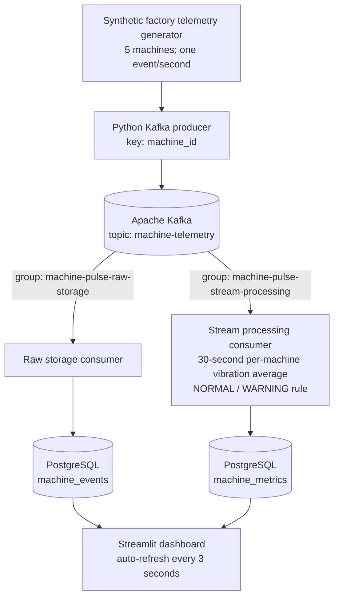

# Machine Pulse — Real-Time Industrial Equipment Monitoring

**Public Streamlit dashboard:** **Deployment pending — replace this line with the public Streamlit URL before submitting.**
**Assignment:** IDS 706 — Week 13 Major Assignment: Real-Time Streaming System with Apache Kafka
**Run environment:** Windows PowerShell, Python 3.12, Docker Desktop

## 1. Project overview and problem

Machine Pulse is an end-to-end event-streaming system that monitors a simulated factory fleet. Five industrial machines continuously emit readings for temperature, vibration, rotational speed, and operating state. An Apache Kafka producer publishes the telemetry; two independent consumer groups store raw readings and compute vibration-based health indicators; PostgreSQL persists both raw and derived data; and a Streamlit dashboard automatically refreshes to show equipment behavior and alerts.

**Why this matters:** A sequence of increasing vibration measurements may reveal a developing equipment problem more reliably than a single measurement. Machine Pulse shows operators how data can move from sensor-like events to searchable history, rolling analytics, and near-real-time visual alerts.

This is **not** the in-class e-commerce/orders example. It uses a purpose-built synthetic industrial telemetry source. No external API key is required.

## 2. System architecture



**Data movement:** Producer → Kafka topic → independent consumers → two PostgreSQL tables → auto-refreshing Streamlit dashboard. Streamlit reads persisted results; it does **not** calculate the streaming rolling average itself.

### Kafka design

| Setting | Value | Reason |
|---|---|---|
| Topic | `machine-telemetry` | Domain-specific name for machine sensor telemetry |
| Message key | `machine_id` | Keying by machine ID keeps successive readings from the same machine in the same Kafka partition and preserves their order within that partition. |
| Raw consumer group | `machine-pulse-raw-storage` | Persists every event independently |
| Processing consumer group | `machine-pulse-stream-processing` | Computes derived results from the same incoming events |
| Verified local configuration | 1 partition; replication factor 1 | Single-broker development configuration (check with `kafka-topics.sh --describe`) |

The two distinct consumer groups each receive the topic's event stream rather than splitting each event between storage and processing.

## 3. Data source and event schema

The source is a continuous Python generator in `producer/producer.py`, using **five simulated machines**: `CNC-01`, `CNC-02`, `PRESS-01`, `PRESS-02`, and `LATHE-01`. Machine-specific temperature, vibration, and RPM baselines produce domain-plausible measurements, with bounded gradual variation instead of independent uniform random values. An `idle` state produces lower temperature, low vibration, and zero RPM. A simulated fault makes the running vibration of `CNC-02` rise after the producer has been operating for one minute.

The producer runs unattended, publishing **one new event approximately every second**. It supports continuous operation by default (`--duration 0`) or a finite demonstration run such as 330 seconds.

Every Kafka message is a JSON object with eight fields, and each field has a matching column in `machine_events`:

| Field | Type | Meaning |
|---|---|---|
| `event_id` | UUID string | Unique ID for each reading; database primary key |
| `event_time` | UTC ISO-8601 timestamp | Time the reading was generated |
| `machine_id` | Category/string | Machine identifier; also the Kafka key |
| `machine_type` | Category/string | CNC, Press, or Lathe |
| `operating_state` | Category/string | Running or idle |
| `temperature_c` | Number | Temperature in degrees Celsius |
| `vibration_mm_s` | Number | Vibration in mm/s |
| `rpm` | Integer | Rotational speed in revolutions per minute |

Example **illustrative** event (actual UUIDs, times, and values vary):

```json
{
  "event_id": "2ee29f26-cbb9-4d2f-a7bf-351b14221e61",
  "event_time": "2026-11-21T20:30:00+00:00",
  "machine_id": "CNC-02",
  "machine_type": "CNC",
  "operating_state": "running",
  "temperature_c": 55.2,
  "vibration_mm_s": 3.8,
  "rpm": 2580
}
```

## 4. Database and stream processing

### Raw storage — `machine_events`

The raw consumer (`consumers/raw_consumer.py`) reads from Kafka and inserts all eight event fields into individually typed PostgreSQL columns. An additional `ingested_at` timestamp records when PostgreSQL received the row. The `event_id` primary key and `ON CONFLICT DO NOTHING` make duplicate-event replay safe for the raw table. A Kafka offset is committed **after** the corresponding database transaction succeeds.

### Derived results — `machine_metrics`

The processing consumer (`consumers/processing_consumer.py`) uses a **different consumer group**. For each machine event, it looks at previously processed readings for the **same machine** in the preceding 30 seconds, includes the incoming reading, and computes:

- `rolling_avg_vibration`: average vibration in the trailing 30-second event-time window;
- `sample_count`: number of readings included in that calculation;
- `alert_status`: `WARNING` when rolling average is **at least 3.0 mm/s**, otherwise `NORMAL`.

The result of **each processed event** is written to the separate `machine_metrics` table (`event_id`, `machine_id`, `event_time`, `vibration_mm_s`, `rolling_avg_vibration`, `sample_count`, `alert_status`, `processed_at`). This provides a persisted, continuously updated derived stream that the dashboard can query without recomputing it. The derived consumer also commits the Kafka offset after successful database processing.

**Important:** The 3.0 mm/s threshold is a **simulation/demo threshold**, not a certified industrial safety limit. The implementation assumes approximately in-order, per-machine events; production event-time processing would require a more explicit late-event/watermark policy.

## 5. Dashboard

The Streamlit app (`dashboard/app.py`) reads both PostgreSQL tables and refreshes its live section **automatically every 3 seconds**, without requiring a browser reload.

**Four summary metrics:** total recorded events; active machines with readings in the previous five minutes; mean temperature in the previous minute; and number of warnings within the selected display range.

**Three domain-specific charts:** (1) per-machine temperature vs. time, (2) per-machine vibration distribution, and (3) persisted 30-second rolling vibration vs. time, including a dashed warning threshold and marked warning events. The dashboard also includes an alert-detail table, a selectable lookback period, UTC timestamps, a stale-data warning, and status/performance information. Time-series curves break across data-collection gaps rather than drawing misleading lines through periods with no measurements.

The dashboard continues to display stored history if the producer is stopped. A **publicly reachable dashboard URL** must be inserted at the top of this README after deployment. If the public environment cannot reach the live database, a clearly identified snapshot of recently persisted results is an acceptable public-facing fallback under the assignment instructions; the local pipeline remains the demonstration of live end-to-end operation.

## 6. Repository layout

```text
machine-pulse-kafka/
├── producer/
│   ├── __init__.py
│   └── producer.py
├── consumers/
│   ├── __init__.py
│   ├── raw_consumer.py
│   └── processing_consumer.py
├── dashboard/
│   └── app.py
├── sql/
│   ├── schema.sql
│   └── metrics.sql
├── docs/
│   └── screenshots/
│       ├── database_ingestion.png
│       ├── stream_processing.png
│       ├── dashboard_live.png
│       ├── producer_5min.png
│       └── pipeline_live.png
├── docker-compose.yml
├── requirements.txt
├── .env.example
├── .gitignore
└── README.md
```

## 7. Reproduce locally (Windows PowerShell)

**Prerequisites:** Docker Desktop with `docker compose`, Python 3.12, and Git. Use the repository root for all commands. Docker Desktop must be running. Open separate terminals for the long-running applications.

### Step 1 — Clone and configure

```powershell
git clone <YOUR_GITHUB_REPO_URL>
cd machine-pulse-kafka
Copy-Item .env.example .env
```

Edit `.env` and set `POSTGRES_PASSWORD` to your chosen local development password. Do **not** commit `.env` or a real database connection string. Compose reads the password from `.env`.

### Step 2 — Install Python dependencies

```powershell
python -m venv .venv
.\.venv\Scripts\python.exe -m pip install -r requirements.txt
```

All subsequent Python commands below use the virtual environment directly; activating it is optional.

### Step 3 — Start Kafka and PostgreSQL

```powershell
docker compose config --quiet
docker compose up -d
docker compose ps
```

Wait for PostgreSQL to show `healthy`. Local PostgreSQL is exposed on `127.0.0.1:5433`; Kafka is exposed on `localhost:9092`.

### Step 4 — Create the database tables

```powershell
Get-Content .\sql\schema.sql -Raw | docker exec -i machine-pulse-postgres psql -U machinepulse -d machinepulse -v ON_ERROR_STOP=1
Get-Content .\sql\metrics.sql -Raw | docker exec -i machine-pulse-postgres psql -U machinepulse -d machinepulse -v ON_ERROR_STOP=1
```

The SQL scripts use `CREATE TABLE IF NOT EXISTS` and can be run again without dropping existing data.

### Step 5 — Create the Kafka topic

```powershell
docker exec machine-pulse-kafka /opt/kafka/bin/kafka-topics.sh --bootstrap-server localhost:9092 --create --if-not-exists --topic machine-telemetry --partitions 1 --replication-factor 1
docker exec machine-pulse-kafka /opt/kafka/bin/kafka-topics.sh --bootstrap-server localhost:9092 --describe --topic machine-telemetry
```

### Step 6 — Start the raw consumer (terminal A)

```powershell
.\.venv\Scripts\python.exe -m consumers.raw_consumer
```

Expected startup message: `Listening to machine-telemetry | group=machine-pulse-raw-storage`.

### Step 7 — Start the processing consumer (terminal B)

```powershell
.\.venv\Scripts\python.exe -m consumers.processing_consumer
```

Expected startup message: `Listening to machine-telemetry | group=machine-pulse-stream-processing`.

### Step 8 — Start the dashboard (terminal C)

```powershell
.\.venv\Scripts\python.exe -m streamlit run dashboard/app.py
```

Open **http://localhost:8501** for the local dashboard.

### Step 9 — Start the producer (terminal D)

To reproduce the validated 5-minute-plus run:

```powershell
.\.venv\Scripts\python.exe -m producer.producer --interval 1 --duration 330
```

This runs autonomously for **330 seconds (5 minutes 30 seconds)**. For continuous operation until interrupted, omit `--duration 330`; press **Ctrl+C** to stop. With consumers running, new data should flow to PostgreSQL and appear on the automatically refreshing dashboard within a few seconds.

### Step 10 — Validate persisted events and computed metrics (terminal E)

Run this query twice while the producer is active; the first two counts should increase:

```powershell
docker exec machine-pulse-postgres psql -U machinepulse -d machinepulse -c "SELECT (SELECT COUNT(*) FROM machine_events) AS raw_events, (SELECT COUNT(*) FROM machine_metrics) AS derived_metrics, (SELECT COUNT(*) FROM machine_metrics WHERE alert_status='WARNING') AS warnings;"
```

Inspect recent warnings:

```powershell
docker exec machine-pulse-postgres psql -U machinepulse -d machinepulse -c "SELECT machine_id, event_time, ROUND(rolling_avg_vibration::numeric,3) AS rolling_avg, sample_count, alert_status FROM machine_metrics WHERE alert_status='WARNING' ORDER BY event_time DESC LIMIT 10;"
```

Optional: inspect the consumer groups:

```powershell
docker exec machine-pulse-kafka /opt/kafka/bin/kafka-consumer-groups.sh --bootstrap-server localhost:9092 --describe --group machine-pulse-raw-storage
docker exec machine-pulse-kafka /opt/kafka/bin/kafka-consumer-groups.sh --bootstrap-server localhost:9092 --describe --group machine-pulse-stream-processing
```

### Stop and resume

Stop the Python processes with **Ctrl+C**. To stop Docker services **without deleting persisted data**, run:

```powershell
docker compose stop
```

Resume with `docker compose up -d`. **Do not use `docker compose down -v`** unless you deliberately intend to erase Kafka and database volumes.

## 8. Demonstrated outcomes and evidence

During the verified local **330-second run**, the producer generated **330 events** without manual interaction. Both consumers processed the new stream: raw database rows increased **420 → 750** and derived rows increased **390 → 720**, exactly **+330 each**. Warning records also increased during the run; a final database check reported **38 cumulative WARNING rows**. The live Streamlit page displayed active equipment, updated KPIs, charts, and the persisted rolling-vibration alerts.

| Evidence | What it demonstrates |
|---|---|
| [Live dashboard](docs/screenshots/dashboard_live.png) | Auto-updating industrial dashboard with summary numbers, charts and warning details |
| [Producer 5+ minute run](docs/screenshots/producer_5min.png) | Producer finishing a 330-second autonomous run with 330 generated events |
| [Database ingestion](docs/screenshots/database_ingestion.png) | Typed event columns and persisted raw telemetry |
| [Stream processing](docs/screenshots/stream_processing.png) | Calculated rolling averages and transitions from NORMAL to WARNING |
| [Pipeline counts](docs/screenshots/pipeline_live.png) | Persisted counts in the raw and derived tables |

The screenshots are **supporting evidence**. The runnable source code, setup instructions, and public dashboard link are the assignment deliverables.

## 9. Limitations and future work

- This project uses synthetic telemetry rather than actual instrumented factory hardware.
- The warning threshold is an illustrative rule, not a safety-certified anomaly detector.
- The basic 30-second calculation expects roughly time-ordered per-machine events. Late/out-of-order events require stronger event-time handling.
- The one-broker, one-partition local Kafka setup is intended for reproducible coursework, not high-availability production operation.
- A future extension could add **sequential vibration prediction / anomaly detection** or **Apache Flink event-time windowing**. Neither is claimed as implemented in this baseline.

## 10. Secrets and repository hygiene

- Real settings belong in local `.env`, which is excluded by `.gitignore`.
- `.env.example` contains placeholders only and is safe to commit.
- No API key is required by the synthetic source.
- The `.venv/` environment, cache files and diagnostic logs are excluded from the repository.
- Before pushing, verify staged files with `git diff --cached --name-only` and check that no credentials are present.

---

**Submission reminder:** Replace the **Dashboard deployment pending** line at the very top with the actual publicly accessible Streamlit URL, verify it in a private browser window, and submit **both** the GitHub repository URL and dashboard URL on Canvas before the deadline.
