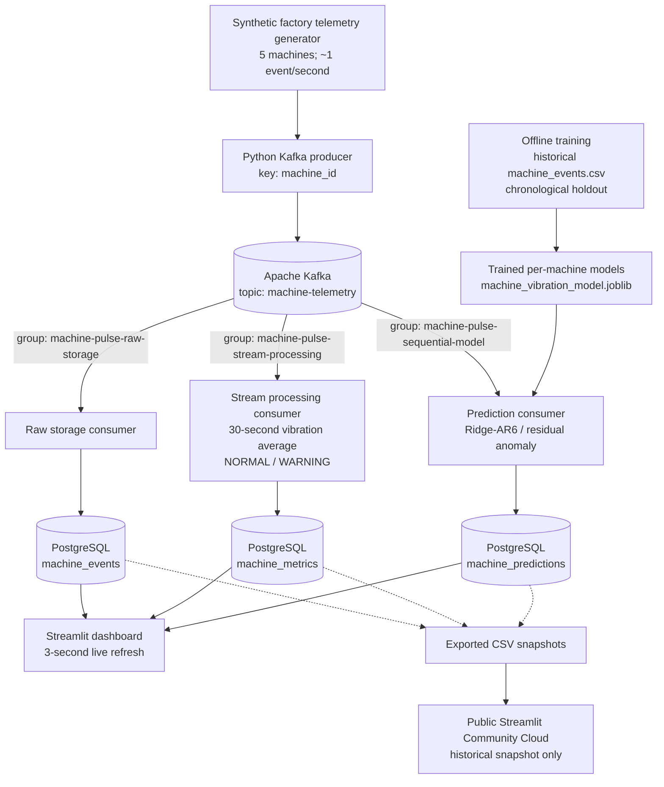

# Machine Pulse — Real-Time Industrial Equipment Monitoring

**Public Streamlit dashboard:** https://machine-pulse-kafka.streamlit.app/

**GitHub repository:** https://github.com/ZhihaoZhou0/machine-pulse-kafka

**Assignment:** IDS 706 — Week 13 Major Assignment: Real-Time Streaming System with Apache Kafka

**Run environment:** Windows PowerShell, Python 3.12, Docker Desktop

## 1. Project overview and problem

Machine Pulse is an end-to-end event-streaming system that monitors a simulated factory fleet. Five industrial machines continuously emit readings for temperature, vibration, rotational speed, and operating state. An Apache Kafka producer publishes the telemetry; three independent consumer groups store raw readings, compute vibration-based health indicators, and perform sequential vibration prediction; PostgreSQL persists raw events, derived metrics, and model predictions; and a Streamlit dashboard automatically refreshes to show equipment behavior and alerts.

**Why this matters:** A sequence of increasing vibration measurements may reveal a developing equipment problem more reliably than a single measurement. Machine Pulse shows operators how data can move from sensor-like events to searchable history, rolling analytics, predictive-maintenance anomaly scores, and near-real-time visual alerts.

This is **not** the in-class e-commerce/orders example. It uses a purpose-built synthetic industrial telemetry source. No external API key is required.

## 2. System architecture



**Data movement:** Producer → Kafka topic → three independent consumers → three PostgreSQL tables → auto-refreshing local Streamlit dashboard. A separately trained per-machine Ridge model is loaded by the prediction consumer. The public deployed app uses exported CSV snapshots rather than connecting to the local Docker database. Streamlit reads persisted results; it does **not** calculate the streaming rolling average itself.

### Kafka design

| Setting | Value | Reason |
|---|---|---|
| Topic | `machine-telemetry` | Domain-specific name for machine sensor telemetry |
| Message key | `machine_id` | Keying by machine ID keeps successive readings from the same machine in the same Kafka partition and preserves their order within that partition. |
| Raw consumer group | `machine-pulse-raw-storage` | Persists every event independently |
| Processing consumer group | `machine-pulse-stream-processing` | Computes derived results from the same incoming events |
| Prediction consumer group | `machine-pulse-sequential-model` | Independently computes next-reading vibration predictions and residual anomaly flags |
| Verified local configuration | 1 partition; replication factor 1 | Single-broker development configuration (check with `kafka-topics.sh --describe`) |

All three consumer groups independently consume the topic rather than sharing the event stream as competing consumers within one group. Within the single local partition, messages are ordered by Kafka offset; `machine_id` remains the meaningful key for future multi-partition scaling.

## 3. Data source and event schema

The source is a continuous Python generator in `producer/producer.py`, using **five simulated machines**: `CNC-01`, `CNC-02`, `PRESS-01`, `PRESS-02`, and `LATHE-01`. Machine-specific temperature, vibration, and RPM baselines produce domain-plausible measurements, with bounded gradual variation instead of independent uniform random values. An `idle` state produces lower temperature, low vibration, and zero RPM. A simulated fault makes the running vibration of `CNC-02` rise after the producer has been operating for one minute.

The producer runs unattended, publishing **one new event approximately every second**. It supports continuous operation by default (`--duration 0`) or a finite demonstration run such as 330 seconds.

Every Kafka message is a JSON object with eight fields, and each field has a matching column in `machine_events`:

| Field | Type | Meaning |
|---|---|---|
| `event_id` | UUID string | Unique ID for each reading; database primary key |
| `event_time` | UTC ISO-8601 timestamp | Time the reading was generated |
| `machine_id` | Category/string | Machine identifier; also the Kafka key |
| `machine_type` | Category/string | CNC, Press, or Lathe |
| `operating_state` | Category/string | Running or idle |
| `temperature_c` | Number | Temperature in degrees Celsius |
| `vibration_mm_s` | Number | Vibration in mm/s |
| `rpm` | Integer | Rotational speed in revolutions per minute |

Example **illustrative** event (actual UUIDs, times, and values vary):

```json
{
  "event_id": "2ee29f26-cbb9-4d2f-a7bf-351b14221e61",
  "event_time": "2026-11-21T20:30:00+00:00",
  "machine_id": "CNC-02",
  "machine_type": "CNC",
  "operating_state": "running",
  "temperature_c": 55.2,
  "vibration_mm_s": 3.8,
  "rpm": 2580
}
```

## 4. Database and stream processing

### Raw storage — `machine_events`

The raw consumer (`consumers/raw_consumer.py`) reads from Kafka and inserts all eight event fields into individually typed PostgreSQL columns. An additional `ingested_at` timestamp records when PostgreSQL received the row. The `event_id` primary key and `ON CONFLICT DO NOTHING` make duplicate-event replay safe for the raw table. A Kafka offset is committed **after** the corresponding database transaction succeeds.

### Derived results — `machine_metrics`

The processing consumer (`consumers/processing_consumer.py`) uses a **different consumer group**. For each machine event, it looks at previously processed readings for the **same machine** in the preceding 30 seconds, includes the incoming reading, and computes:

- `rolling_avg_vibration`: average vibration in the trailing 30-second event-time window;
- `sample_count`: number of readings included in that calculation;
- `alert_status`: `WARNING` when rolling average is **at least 3.0 mm/s**, otherwise `NORMAL`.

The result of **each processed event** is written to the separate `machine_metrics` table (`event_id`, `machine_id`, `event_time`, `vibration_mm_s`, `rolling_avg_vibration`, `sample_count`, `alert_status`, `processed_at`). This provides a persisted, continuously updated derived stream that the dashboard can query without recomputing it. The derived consumer also commits the Kafka offset after successful database processing.

**Important:** The 3.0 mm/s threshold is a **simulation/demo threshold**, not a certified industrial safety limit. The implementation assumes approximately in-order, per-machine events; production event-time processing would require a more explicit late-event/watermark policy.

### Sequential prediction results — `machine_predictions`

The third consumer (`consumers/prediction_consumer.py`) uses its own Kafka group, loads the trained `Ridge-AR6` model bundle, and predicts each machine's current vibration from its **six preceding readings**. Each prediction is persisted in `machine_predictions` with `event_id`, `machine_id`, `event_time`, actual and predicted vibration, absolute error, anomaly threshold, `is_anomaly`, model name, and `predicted_at`. A primary key on `event_id` prevents duplicate prediction rows on replay. The consumer commits a Kafka offset only after successful processing and database persistence. A gap longer than 15 seconds resets its short per-machine history. See Section 8 for model assumptions, training, evaluation, and commands.

**This is different from the required 30-second rolling-average alert:** the required stream processor uses a fixed level threshold, while the bonus predicts the next value from a sequence and flags unusually large **prediction residuals**.

## 5. Dashboard

The Streamlit app (`dashboard/app.py`) reads both PostgreSQL tables and refreshes its live section **automatically every 3 seconds**, without requiring a browser reload.

**Four summary metrics:** total recorded events; active machines with readings in the previous five minutes; mean temperature in the previous minute; and number of warnings within the selected display range.

**Three domain-specific charts:** (1) per-machine temperature vs. time, (2) per-machine vibration distribution, and (3) persisted 30-second rolling vibration vs. time, including a dashed warning threshold and marked warning events. The dashboard also includes an alert-detail table, a selectable lookback period, UTC timestamps, a stale-data warning, and status/performance information. Time-series curves break across data-collection gaps rather than drawing misleading lines through periods with no measurements.

The dashboard also includes a **Predictive Maintenance — Sequential Modeling Bonus** section: model prediction counts, flagged anomalies, mean absolute prediction error, a five-machine selector, actual-versus-predicted vibration, prediction error versus the trained threshold, a table of flagged readings, and a collapsible chronological-holdout evaluation report.

The local dashboard reads PostgreSQL and refreshes every 3 seconds while running. When no recent events exist, it explicitly labels a historical view and anchors the displayed period to the latest stored event. The [public deployed dashboard](https://machine-pulse-kafka.streamlit.app/) is a **historical CSV snapshot demonstration**, *not* a publicly live Kafka feed. It uses `data/machine_events.csv`, `data/machine_metrics.csv`, and `data/machine_predictions.csv`, with the latest exported data available at build/deployment time. This distinction is shown clearly in the app. The local pipeline demonstrates the required live end-to-end flow.

## 6. Repository layout

```text
machine-pulse-kafka/
├── producer/
│   ├── __init__.py
│   └── producer.py
├── consumers/
│   ├── __init__.py
│   ├── raw_consumer.py
│   ├── processing_consumer.py
│   └── prediction_consumer.py
├── modeling/
│   ├── __init__.py
│   ├── train_model.py
│   ├── machine_vibration_model.joblib
│   └── model_report.json
├── dashboard/
│   └── app.py
├── data/
│   ├── machine_events.csv
│   ├── machine_metrics.csv
│   └── machine_predictions.csv
├── sql/
│   ├── schema.sql
│   ├── metrics.sql
│   └── predictions.sql
├── docs/
│   └── screenshots/
│       ├── database_ingestion.png
│       ├── stream_processing.png
│       ├── dashboard_live.png
│       ├── producer_5min.png
│       ├── pipeline_live.png
│       ├── sequential_modeling.png
│       └── sequential_dashboard.png
├── docker-compose.yml
├── requirements.txt
├── .env.example
├── .gitignore
└── README.md
```

## 7. Reproduce locally (Windows PowerShell)

**Prerequisites:** Docker Desktop with `docker compose`, Python 3.12, and Git. Use the repository root for all commands. Docker Desktop must be running. Open separate terminals for the long-running applications.

### Step 1 — Clone and configure

```powershell
git clone https://github.com/ZhihaoZhou0/machine-pulse-kafka.git
cd machine-pulse-kafka
Copy-Item .env.example .env
```

Edit `.env` and set `POSTGRES_PASSWORD` to your chosen local development password. Do **not** commit `.env` or a real database connection string. Compose reads the password from `.env`.

### Step 2 — Install Python dependencies

```powershell
python -m venv .venv
.\.venv\Scripts\python.exe -m pip install -r requirements.txt
```

All subsequent Python commands below use the virtual environment directly; activating it is optional.

### Step 3 — Start Kafka and PostgreSQL

```powershell
docker compose config --quiet
docker compose up -d
docker compose ps
```

Wait for PostgreSQL to show `healthy`. Local PostgreSQL is exposed on `127.0.0.1:5433`; Kafka is exposed on `localhost:9092`.

### Step 4 — Create the database tables

```powershell
Get-Content .\sql\schema.sql -Raw | docker exec -i machine-pulse-postgres psql -U machinepulse -d machinepulse -v ON_ERROR_STOP=1
Get-Content .\sql\metrics.sql -Raw | docker exec -i machine-pulse-postgres psql -U machinepulse -d machinepulse -v ON_ERROR_STOP=1
Get-Content .\sql\predictions.sql -Raw | docker exec -i machine-pulse-postgres psql -U machinepulse -d machinepulse -v ON_ERROR_STOP=1
```

The SQL scripts use `CREATE TABLE IF NOT EXISTS` and can be run again without dropping existing data.

### Step 5 — Create the Kafka topic

```powershell
docker exec machine-pulse-kafka /opt/kafka/bin/kafka-topics.sh --bootstrap-server localhost:9092 --create --if-not-exists --topic machine-telemetry --partitions 1 --replication-factor 1
docker exec machine-pulse-kafka /opt/kafka/bin/kafka-topics.sh --bootstrap-server localhost:9092 --describe --topic machine-telemetry
```

### Step 6 — Start the raw consumer (terminal A)

```powershell
.\.venv\Scripts\python.exe -m consumers.raw_consumer
```

Expected startup message: `Listening to machine-telemetry | group=machine-pulse-raw-storage`.

### Step 7 — Start the processing consumer (terminal B)

```powershell
.\.venv\Scripts\python.exe -m consumers.processing_consumer
```

Expected startup message: `Listening to machine-telemetry | group=machine-pulse-stream-processing`.

**Optional Bonus — train models before the next producer run (terminal C):**

```powershell
.\.venv\Scripts\python.exe -m modeling.train_model
```

This uses the included historical `data/machine_events.csv` and writes `modeling/machine_vibration_model.joblib` and `modeling/model_report.json`. If using the repository's already trained artifact for a repeatable demo, retraining is optional.

**Optional Bonus — start the third prediction consumer (new terminal):**

```powershell
.\.venv\Scripts\python.exe -m consumers.prediction_consumer
```

Expected message: `Listening to machine-telemetry | group=machine-pulse-sequential-model | model=Ridge-AR6`. Start it **before a fresh producer run** so it can consume the new stream and maintain correctly ordered per-machine histories. Only load locally trained or otherwise trusted `.joblib` artifacts.

### Step 8 — Start the dashboard (separate terminal)

```powershell
.\.venv\Scripts\python.exe -m streamlit run dashboard/app.py
```

Open **http://localhost:8501** for the local dashboard.

### Step 9 — Start the producer (separate terminal)

To reproduce the validated 5-minute-plus run:

```powershell
.\.venv\Scripts\python.exe -m producer.producer --interval 1 --duration 330
```

This runs autonomously for **330 seconds (5 minutes 30 seconds)**. For continuous operation until interrupted, omit `--duration 330`; press **Ctrl+C** to stop. With consumers running, new data should flow to PostgreSQL and appear on the automatically refreshing dashboard within a few seconds.

### Step 10 — Validate persisted events and computed metrics (separate terminal)

Run this query twice while the producer is active; the first two counts should increase:

```powershell
docker exec machine-pulse-postgres psql -U machinepulse -d machinepulse -c "SELECT (SELECT COUNT(*) FROM machine_events) AS raw_events, (SELECT COUNT(*) FROM machine_metrics) AS derived_metrics, (SELECT COUNT(*) FROM machine_metrics WHERE alert_status='WARNING') AS warnings;"
```

Inspect recent warnings:

```powershell
docker exec machine-pulse-postgres psql -U machinepulse -d machinepulse -c "SELECT machine_id, event_time, ROUND(rolling_avg_vibration::numeric,3) AS rolling_avg, sample_count, alert_status FROM machine_metrics WHERE alert_status='WARNING' ORDER BY event_time DESC LIMIT 10;"
```

Optional: inspect the consumer groups:

```powershell
docker exec machine-pulse-kafka /opt/kafka/bin/kafka-consumer-groups.sh --bootstrap-server localhost:9092 --describe --group machine-pulse-raw-storage
docker exec machine-pulse-kafka /opt/kafka/bin/kafka-consumer-groups.sh --bootstrap-server localhost:9092 --describe --group machine-pulse-stream-processing
docker exec machine-pulse-kafka /opt/kafka/bin/kafka-consumer-groups.sh --bootstrap-server localhost:9092 --describe --group machine-pulse-sequential-model
```

### Stop and resume

Stop the Python processes with **Ctrl+C**. To stop Docker services **without deleting persisted data**, run:

```powershell
docker compose stop
```

Resume with `docker compose up -d`. **Do not use `docker compose down -v`** unless you deliberately intend to erase Kafka and database volumes.

## 8. Sequential modeling extension (Bonus)

### Problem and modeling approach

A fixed vibration threshold can flag sustained high vibration, but it does not directly measure whether a **new reading is surprising given the recent sequence**. The extension uses a separate **per-machine, one-step-ahead autoregressive predictor**: six prior vibration measurements (`lag_1` through `lag_6`) predict the next reading. Each per-machine model is a `StandardScaler` followed by `Ridge(alpha=5.0)`; the consumer uses the stored trained model to score Kafka events as they arrive.

For current vibration `v_t`, the model produces `predicted_vibration`; it stores `absolute_error = abs(v_t - predicted_vibration)` and flags `is_anomaly` when the absolute error **exceeds** the machine's stored training-calibrated error threshold. These are *prediction-error outliers*, not verified hardware failures.

### Leakage prevention and anomaly calibration

- Construct samples **independently for each machine**, ordered by event time; six lag readings must precede the prediction target.
- Do not bridge sampling gaps longer than **15 seconds** when building training examples or when scoring a new stream session.
- Split each machine's sequence examples **chronologically 70% training pool / 30% holdout**, avoiding random future-to-past leakage.
- For model fitting, retain training examples whose target and six lag readings represent simulated running/normal vibration (heuristic normal range **0.5–3.0 mm/s**; all states must be `running`). This is not ground-truth fault labeling.
- Calibrate each machine's residual threshold from **training residuals only**: the greater of **0.35 mm/s** and the training 99th-percentile absolute error. All five trained thresholds in this run equaled the 0.35 minimum; per-device threshold adaptivity was therefore limited.
- Evaluate the later holdout with MAE, RMSE, and flag counts. **Do not interpret anomaly flag counts as precision or recall**, since verified fault labels are unavailable.

### Observed chronological-holdout evaluation

| Machine | Normal training samples | Holdout samples | Holdout MAE (mm/s) | Holdout RMSE (mm/s) | Residual threshold (mm/s) | Flags |
|---|---:|---:|---:|---:|---:|---:|
| CNC-01 | 25 | 35 | 0.3180 | 0.5646 | 0.350 | 8 |
| CNC-02 | 30 | 35 | 1.0428 | 1.8861 | 0.350 | 24 |
| LATHE-01 | 42 | 35 | 0.2379 | 0.4606 | 0.350 | 5 |
| PRESS-01 | 52 | 35 | 0.5034 | 0.8359 | 0.350 | 10 |
| PRESS-02 | 48 | 35 | 0.2158 | 0.4722 | 0.350 | 5 |
| **Total** | **197** | **175** | — | — | — | **52** |

CNC-02 showed the largest holdout error and most residual anomaly flags, consistent with the simulator's changing-vibration scenario. This is an **observed behavior in synthetic data**, not a verified detection performance claim. The dashboard's *mean absolute error for the selected displayed predictions* is a separate metric from holdout MAE.

### Run and verify the Kafka inference extension

Apply `sql/predictions.sql`, then start the **prediction consumer** before the producer (see Section 7). It subscribes to `machine-telemetry` as `machine-pulse-sequential-model`, loads `modeling/machine_vibration_model.joblib`, maintains an ordered six-reading history per machine, and inserts predictions into `machine_predictions`. A `PRIMARY KEY(event_id)` plus `ON CONFLICT DO NOTHING` avoids duplicate prediction rows.

A short integration demonstration can be started in the producer terminal:

```powershell
.\.venv\Scripts\python.exe -m producer.producer --interval 1 --duration 180
```

In another terminal, repeat the query while the producer is active:

```powershell
docker exec machine-pulse-postgres psql -U machinepulse -d machinepulse -c "SELECT COUNT(*) AS predictions, COUNT(*) FILTER (WHERE is_anomaly) AS anomalies, COUNT(DISTINCT machine_id) AS machines FROM machine_predictions;"
```

Inspect model-derived anomalies:

```powershell
docker exec machine-pulse-postgres psql -U machinepulse -d machinepulse -c "SELECT machine_id, ROUND(actual_vibration::numeric,3) AS actual, ROUND(predicted_vibration::numeric,3) AS predicted, ROUND(absolute_error::numeric,3) AS error, ROUND(anomaly_threshold::numeric,3) AS threshold FROM machine_predictions WHERE is_anomaly = TRUE ORDER BY event_time DESC LIMIT 10;"
```

**Observed integration test:** the prediction table grew from **30 predictions / 0 flags** to **97 / 15**, then **175 / 28**, then **180 / 31**, covering all **five machines**. This demonstrates incremental persistence as events were processed. The additional predicted results and flags are not evidence that 31 real-world faults occurred. A fresh run may have different totals because sequence warmups, previously committed offsets, and synthetic values vary.

### Dashboard integration and hosted demonstration

The local dashboard reads `machine_predictions` and shows prediction count, residual-flag count, selected-range mean absolute error, device count, **Actual vs Predicted Vibration**, **Prediction Error vs Calibrated Threshold**, an anomalies table, and a chronological holdout summary. The public Streamlit app displays an **exported snapshot** from `data/machine_predictions.csv` rather than a live database connection. To update its demonstration data, export all three database tables and commit the CSV files, then deploy the updated GitHub revision. The public app must not be described as receiving new Kafka events in real time.

## 9. Demonstrated outcomes and evidence

During the verified local **330-second run**, the producer generated **330 events** without manual interaction. Both consumers processed the new stream: raw database rows increased **420 → 750** and derived rows increased **390 → 720**, exactly **+330 each**. Warning records also increased during the run; a final database check reported **38 cumulative WARNING rows**. The live Streamlit page displayed active equipment, updated KPIs, charts, and the persisted rolling-vibration alerts.

| Evidence | What it demonstrates |
|---|---|
| [Live dashboard](docs/screenshots/dashboard_live.png) | Auto-updating industrial dashboard with summary numbers, charts and warning details |
| [Producer 5+ minute run](docs/screenshots/producer_5min.png) | Producer finishing a 330-second autonomous run with 330 generated events |
| [Database ingestion](docs/screenshots/database_ingestion.png) | Typed event columns and persisted raw telemetry |
| [Stream processing](docs/screenshots/stream_processing.png) | Calculated rolling averages and transitions from NORMAL to WARNING |
| [Pipeline counts](docs/screenshots/pipeline_live.png) | Persisted counts in the raw and derived tables |
| [Sequential model inference](docs/screenshots/sequential_modeling.png) | Prediction count and model anomaly flags increase while the prediction consumer processes Kafka events |
| [Predictive-maintenance dashboard](docs/screenshots/sequential_dashboard.png) | Actual-vs-predicted charts, residual anomaly plot, model predictions and anomaly details |

The screenshots are **supporting evidence**. The runnable source code, setup instructions, and public dashboard link are the assignment deliverables.

## 10. Limitations and future work

- This project uses synthetic telemetry rather than actual instrumented factory hardware.
- The warning threshold is an illustrative rule, not a safety-certified anomaly detector.
- The basic 30-second calculation expects roughly time-ordered per-machine events. Late/out-of-order events require stronger event-time handling.
- The one-broker, one-partition local Kafka setup is intended for reproducible coursework, not high-availability production operation.
- The **sequential Ridge-AR6 prediction extension is implemented** and tested on synthetic data; no verified ground-truth fault labels, precision, recall, or production-grade calibration are claimed.
- Historical normal-training samples are relatively few (25–52 per machine); all learned residual thresholds hit the 0.35 mm/s floor. Stronger calibration and more varied normal data would be needed before operational use.
- Prediction history recovery/offset handling assumes a correctly ordered demo stream; a production system would need stronger transactional recovery and late-event handling.
- Apache Flink is **not implemented**. It is an alternative future streaming/windowing extension.

## 11. Secrets and repository hygiene

- Real settings belong in local `.env`, which is excluded by `.gitignore`.
- `.env.example` contains placeholders only and is safe to commit.
- No API key is required by the synthetic source.
- The `.venv/` environment, cache files and diagnostic logs are excluded from the repository.
- Before pushing, verify staged files with `git diff --cached --name-only` and check that no credentials are present.

---

**Submission reminder:** Verify the [public Streamlit dashboard](https://machine-pulse-kafka.streamlit.app/) in a private browser window after deploying the latest changes. Submit **both** the [GitHub repository](https://github.com/ZhihaoZhou0/machine-pulse-kafka) and the dashboard URL on Canvas before the deadline. The GitHub and public snapshot must be updated to include the bonus files before claiming that the publicly hosted version displays the extension.
